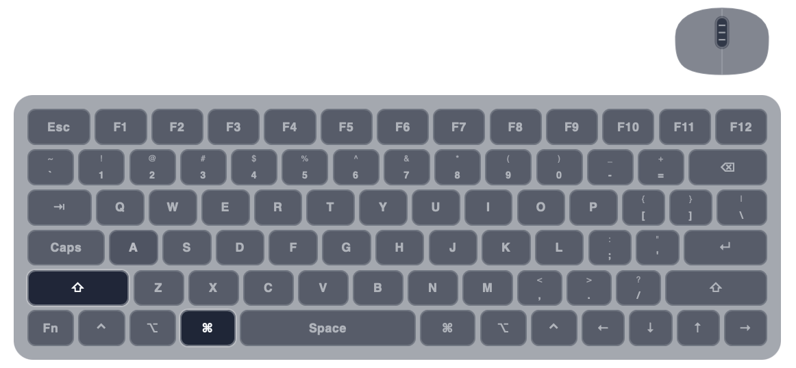
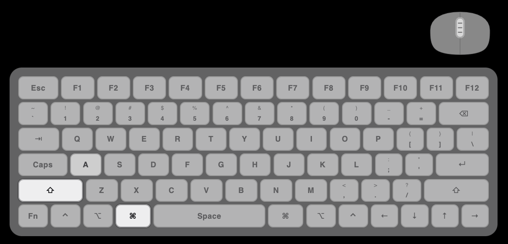

# z-key-cast

[English](./README.md) | 简体中文

录屏时在屏幕角落显示键盘与鼠标操作的跨平台 HUD。

- **仓库：** https://gitee.com/zhupengji/z-key-cast
- **发布：** https://gitee.com/zhupengji/z-key-cast/releases

<p align="center">
  
  &nbsp;
  
</p>
<p align="center">
  
</p>

## 功能

- **角落 HUD** — Text · Lite · Full 三档预设；可改四角位置，支持拖拽放置
- **全局捕获** — 键盘与鼠标（macOS / Windows；Linux 视平台能力）
- **托盘** — 打开设置、退出（运行期间 HUD 常开；X 仅隐藏设置窗）
- **点击涟漪** — macOS / Windows 主屏可选点击圆环
- **多语言** — 界面中英切换

## 技术栈

- Tauri 2
- SvelteKit + TypeScript
- pnpm

## 开发

```bash
pnpm install
pnpm tauri dev
```

| 窗口 | 路由 | 用途 |
|---|---|---|
| `main` | `/` | 设置 / 日志 / 关于 |
| `overlay` | `/overlay` | 透明角落 HUD |

打包：

```bash
pnpm tauri build
```

### 局域网站点与更新（内测）

见 [`website/README.zh-CN.md`](./website/README.zh-CN.md)（[English](./website/README.md)）：`website/publish/` 本地静态根、`site:publish-test`、macOS updater C 级闭环。公开/`pnpm tauri build` 包**不**启用更新；Gitee Release 仍为手动上传。

## 文档

- 产品与架构 → [`design/index.md`](./design/index.md)
- UI 说明 → [`design/02-ui.md`](./design/02-ui.md)
- 更新日志 → [`CHANGELOG.md`](./CHANGELOG.md)

## 许可

MIT
